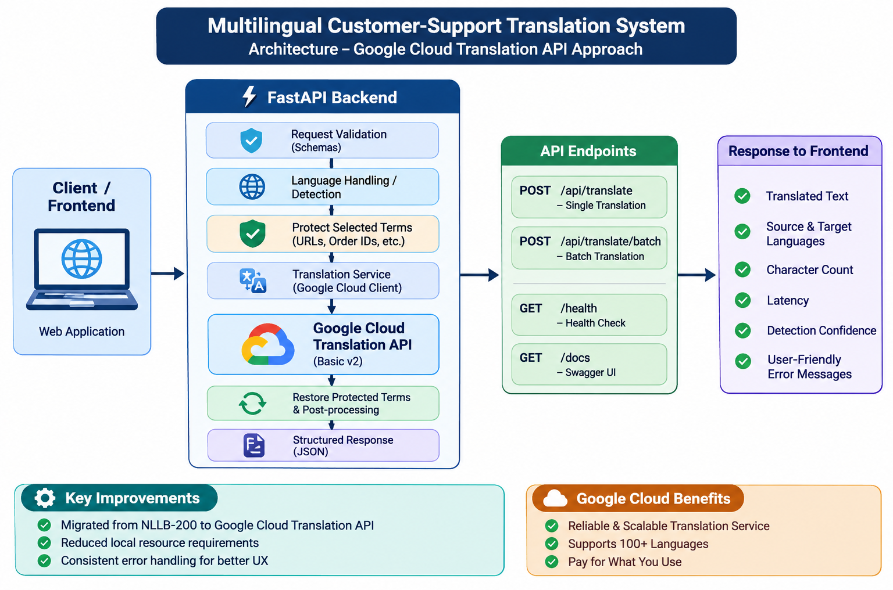

# Multilingual Customer-Support Translation System

A multilingual translation system built with **FastAPI, Google Cloud Translation API, and Python**.

The application translates customer-support messages between English, French, Spanish, Hindi, and Tamil through single-message and batch REST API endpoints. It also includes automatic language detection, protected-term restoration, input character counting, and translation latency reporting.

## Live Demo

https://multilingual-translation-system-hu6a.onrender.com/

---

## Table of Contents

- [Multilingual Customer-Support Translation System](#multilingual-customer-support-translation-system)
  - [Live Demo](#live-demo)
  - [Table of Contents](#table-of-contents)
  - [Project Overview](#project-overview)
  - [Features](#features)
  - [Technology Stack](#technology-stack)
  - [Supported Languages](#supported-languages)
  - [Translation Configuration](#translation-configuration)
  - [System Architecture](#system-architecture)
  - [Project Structure](#project-structure)
    - [Module Responsibilities](#module-responsibilities)
  - [Prerequisites](#prerequisites)
  - [Installation and Setup](#installation-and-setup)
    - [1. Clone the Repository](#1-clone-the-repository)
    - [2. Create a Virtual Environment](#2-create-a-virtual-environment)
    - [3. Install Dependencies](#3-install-dependencies)
    - [4. Configure Environment Variables](#4-configure-environment-variables)
  - [Running the Application](#running-the-application)
  - [API Endpoints](#api-endpoints)
    - [1. Single Translation](#1-single-translation)
    - [2. Batch Translation](#2-batch-translation)
  - [Testing](#testing)
    - [Using Swagger UI](#using-swagger-ui)
    - [Using curl](#using-curl)
    - [Running Unit Tests](#running-unit-tests)
  - [Performance and Limitations](#performance-and-limitations)
    - [Translation Quality](#translation-quality)
    - [API Performance](#api-performance)
    - [Language Detection](#language-detection)
    - [Resource Requirements](#resource-requirements)
    - [Evaluation](#evaluation)
  - [Deployment](#deployment)
  - [API Usage and Licensing](#api-usage-and-licensing)
  - [Future Improvements](#future-improvements)
  - [Author](#author)
    - [Areas of Interest](#areas-of-interest)

---

## Project Overview

Customer-support teams often receive messages in different languages. This project provides a translation API to help process messages across language barriers.

The application uses Google Cloud Translation API to translate text between supported languages. Its modular backend separates configuration, API client initialization, language handling, request validation, term protection, and translation logic.

The project initially used Meta's NLLB-200 Distilled 600M model for local translation inference. During deployment, the model's memory requirements exceeded the resources available on the selected Render hosting tier. After evaluating alternative approaches, the translation layer was migrated to Google Cloud Translation API to support a lighter application deployment without loading a large machine-learning model locally.

## Features

- **Multilingual translation:** Supports configured language directions across five languages.
- **Single translation:** Translates one message per API request.
- **Batch translation:** Processes multiple messages in one request.
- **Automatic language detection:** Detects the source language when it is not explicitly provided.
- **Term protection:** Helps preserve selected technical terms, identifiers, URLs, and other protected text.
- **Translation metadata:** Returns language details, input character counts, and processing latency.
- **REST API:** Exposes translation functionality through FastAPI.
- **Interactive API documentation:** Supports endpoint testing through Swagger UI.
- **Modular architecture:** Separates configuration, API client, language detection, schemas, and translation logic.
- **Automated tests:** Includes tests for language detection, term protection, and translation service behaviour.

## Technology Stack

| Technology | Purpose |
|---|---|
| Python | Core programming language |
| FastAPI | REST API framework |
| Uvicorn | ASGI application server |
| Google Cloud Translation API (Basic v2) | Translation service |
| Requests | HTTP communication with Google API |
| langdetect | Automatic language detection |
| Pydantic | Request validation and data schemas |
| Pydantic Settings | Application configuration |
| pytest | Automated testing |
| HTML, CSS, JavaScript | Frontend interface |

## Supported Languages

| Language | API Code |
|---|---|
| English | `en` |
| French | `fr` |
| Spanish | `es` |
| Hindi | `hi` |
| Tamil | `ta` |

The application supports translation between the configured languages, including:

- English ↔ French
- English ↔ Spanish
- English ↔ Hindi
- English ↔ Tamil
- French ↔ Spanish, Hindi, and Tamil
- Spanish ↔ Hindi and Tamil
- Hindi ↔ Tamil

The source language can be selected manually or detected automatically.

## Translation Configuration

| Setting | Current Value |
|---|---|
| Translation provider | Google Cloud Translation |
| API version | Basic v2 |
| API endpoint | `https://translation.googleapis.com/language/translate/v2` |
| Translation approach | Cloud-based API translation |
| Request format | JSON |
| Supported languages | English, French, Spanish, Hindi, Tamil |
| Maximum input length | 10,000 characters per message |
| Maximum batch messages | 32 |
| Batch request handling | Grouped by detected source language |
| Batch character limit | 25,000 characters per provider request |

The application sends translation requests to Google Cloud Translation API instead of loading a translation model into local memory.

For batch translation, messages are grouped by their resolved source language. Large groups are divided into smaller requests while preserving the original message order in the response.

The application does not train or host a translation model locally.

## System Architecture

```text
Client / Browser
       |
       v
    FastAPI
       |
       v
 Request Validation
       |
       v
Language Handling / Detection
       |
       v
 Protect Selected Terms
       |
       v
 Translation Service
       |
       v
Google Cloud Translation API
       |
       v
 Restore Protected Terms
       |
       v
 Post-processing
       |
       v
 JSON Translation Response
```

For batch requests, messages are grouped by source language and sent to Google Cloud Translation API in batches. Results are restored to their original input order before returning the response.



## Project Structure

```text
multilingual-translation-system/
│
├── app/
│   ├── __init__.py
│   ├── config.py
│   ├── language_detection.py
│   ├── main.py
│   ├── model_loader.py
│   ├── schemas.py
│   ├── term_protection.py
│   └── translation_service.py
│
├── static/
│   ├── icons/
│   │   ├── github.png
│   │   └── linkedin.png
│   ├── script.js
│   └── style.css
│
├── templates/
│   └── index.html
│
├── tests/
│   ├── test_language_detection.py
│   ├── test_term_protection.py
│   └── test_translation_service.py
│
├── .env.example
├── .gitignore
├── .python-version
├── README.md
├── render.yaml
└── requirements.txt
```

### Module Responsibilities

| Module | Responsibility |
|---|---|
| `config.py` | Application settings, API configuration, and language mappings |
| `language_detection.py` | Source-language detection |
| `main.py` | FastAPI application lifecycle, health check, and API endpoints |
| `model_loader.py` | Google Cloud Translation API client initialization and communication |
| `schemas.py` | Request and response validation |
| `term_protection.py` | Protection and restoration of selected terms |
| `translation_service.py` | Single and batch translation logic |
| `tests/` | Unit and translation service tests |

## Prerequisites

- Python 3.11 recommended for a consistent development environment.
- Git.
- Internet access for communication with Google Cloud Translation API.
- A Google Cloud project with Cloud Translation API enabled.
- A configured Google Cloud Translation API key.
- Billing enabled for the Google Cloud project, subject to Google's applicable pricing and free usage allowance.

No local GPU or large machine-learning model download is required.

## Installation and Setup

### 1. Clone the Repository

Replace `YOUR_GITHUB_USERNAME` with your GitHub username.

```bash
git clone https://github.com/YOUR_GITHUB_USERNAME/multilingual-translation-system.git
cd multilingual-translation-system
```

### 2. Create a Virtual Environment

**Windows PowerShell**

```powershell
py -3.11 -m venv .venv
.\.venv\Scripts\Activate.ps1
```

**macOS / Linux**

```bash
python3.11 -m venv .venv
source .venv/bin/activate
```

### 3. Install Dependencies

```bash
python -m pip install --upgrade pip
python -m pip install -r requirements.txt
```

Install pytest if it is not already available:

```bash
python -m pip install pytest
```

### 4. Configure Environment Variables

If `.env.example` is present, create a local `.env` file.

**Windows PowerShell**

```powershell
Copy-Item .env.example .env
```

**macOS / Linux**

```bash
cp .env.example .env
```

Configure the Google Cloud Translation API key in `.env`:

```env
GOOGLE_TRANSLATE_API_KEY=your_google_cloud_translation_api_key
```

The application reads the API key from the environment configuration.

Never commit your real API key or other credentials to source control. The `.env` file should remain excluded through `.gitignore`.

## Running the Application

From the project root, start the development server:

```bash
python -m uvicorn app.main:app --reload
```

Once the server starts, access the following URLs:

| Resource | URL |
|---|---|
| Application | [http://127.0.0.1:8000](http://127.0.0.1:8000) |
| Swagger documentation | [http://127.0.0.1:8000/docs](http://127.0.0.1:8000/docs) |
| ReDoc documentation | [http://127.0.0.1:8000/redoc](http://127.0.0.1:8000/redoc) |
| Health endpoint | [http://127.0.0.1:8000/health](http://127.0.0.1:8000/health) |

The application initializes the Google Cloud Translation API client during startup. A valid API key is required for translation requests.

Stop the server using `Ctrl+C`.

## API Endpoints

| Method | Endpoint | Description |
|---|---|---|
| `GET` | `/` | Serves the translation application |
| `GET` | `/health` | Health/status check |
| `POST` | `/api/translate` | Translate a single message |
| `POST` | `/api/translate/batch` | Translate multiple messages |

### 1. Single Translation

**Endpoint:** `POST /api/translate`

Example request:

```json
{
  "text": "I need a device to test this application",
  "source_language": "en",
  "target_language": "ta",
  "protect_terms": true
}
```

The `source_language` field is optional. Omit it to enable automatic language detection.

Example response:

```json
{
  "source_text": "I need a device to test this application",
  "translated_text": "இந்த பயன்பாட்டை சோதிக்க எனக்கு ஒரு சாதனம் தேவை",
  "source_language": "en",
  "source_language_name": "English",
  "target_language": "ta",
  "target_language_name": "Tamil",
  "source_nllb_code": "eng_Latn",
  "target_nllb_code": "tam_Taml",
  "detected_confidence": 1,
  "detection_note": "Source language provided by caller.",
  "input_token_count": 0,
  "input_character_count": 40,
  "latency_ms": 815.09
}
```

The response illustrates the current response structure. Translation output and latency can vary between requests.

The legacy `source_nllb_code` and `target_nllb_code` fields are retained for response compatibility. Google Cloud Translation API uses standard language codes such as `en`, `fr`, `es`, `hi`, and `ta`.

### 2. Batch Translation

**Endpoint:** `POST /api/translate/batch`

The batch endpoint accepts up to 32 messages and returns an individual result for each message.

Example request:

```json
{
  "messages": [
    "What is my order status?",
    "Please cancel my subscription and process the refund."
  ],
  "target_language": "ta",
  "protect_terms": true
}
```

Example response structure:

```json
{
  "count": 2,
  "results": [
    {
      "source_text": "What is my order status?",
      "translated_text": "என் ஆர்டர் நிலை என்ன?",
      "source_language": "en",
      "source_language_name": "English",
      "target_language": "ta",
      "target_language_name": "Tamil",
      "source_nllb_code": "eng_Latn",
      "target_nllb_code": "tam_Taml",
      "detected_confidence": 1,
      "detection_note": "Source language provided by caller.",
      "input_token_count": 0,
      "input_character_count": 25,
      "latency_ms": 450.00
    }
  ]
}
```

The example response is illustrative. Actual results depend on the submitted messages and translation provider response.

The batch endpoint supports automatic source-language detection for individual messages when `source_language` is omitted. Results are returned in the same order as the original messages.

## Testing

### Using Swagger UI

1. Start the application.
2. Open [http://127.0.0.1:8000/docs](http://127.0.0.1:8000/docs).
3. Expand `POST /api/translate` or `POST /api/translate/batch`.
4. Click **Try it out**.
5. Enter a request matching the displayed schema.
6. Click **Execute** and inspect the response.

### Using curl

Check the health endpoint:

```bash
curl http://127.0.0.1:8000/health
```

Example single translation request:

```bash
curl -X POST "http://127.0.0.1:8000/api/translate" \
  -H "Content-Type: application/json" \
  -d "{\"text\":\"I need a device to test this application\",\"source_language\":\"en\",\"target_language\":\"ta\"}"
```

### Running Unit Tests

Run all tests from the project root:

```bash
python -m pytest -q
```

Run individual test files:

```bash
python -m pytest -q tests/test_language_detection.py
python -m pytest -q tests/test_term_protection.py
python -m pytest -q tests/test_translation_service.py
```

The translation service test requires a valid Google Cloud Translation API key and internet connectivity.

These tests cover selected components. Additional integration tests should verify the running API and translation behaviour across all configured language directions.

## Performance and Limitations

### Translation Quality

Google Cloud Translation API provides multilingual translation capabilities, but some sentences may sound unnatural or lose nuance. Quality depends on the language pair, context, spelling, informal language, and technical terminology.

A successful HTTP `200` response means the request was processed; it does not guarantee a perfect translation.

### API Performance

Translation requests are processed by Google Cloud Translation API. Latency depends on network conditions, message length, batch size, provider processing time, and service availability.

Batch processing groups messages by source language and divides large groups into smaller requests to manage request size.

### Language Detection

Automatic language detection may be unreliable for very short messages, names, identifiers, and mixed-language text. Providing the source language explicitly is preferable when it is known.

### Resource Requirements

The application no longer loads a large translation model into local memory. This significantly reduces application memory requirements compared with the original NLLB-200 implementation.

However, the application still requires internet connectivity and access to Google Cloud Translation API. Translation requests may fail if the provider is unavailable, the API key is invalid, billing or API configuration is incorrect, or usage limits are reached.

### Evaluation

Translation quality should be evaluated using a representative dataset, automated metrics such as BLEU and chrF, and human review. Testing multiple language pairs and unseen customer-support messages is important before production use.

## Deployment

The repository includes `render.yaml` if that file is committed. Review the deployment configuration before deploying.

A typical Uvicorn start command for a hosted service is:

```bash
uvicorn app.main:app --host 0.0.0.0 --port $PORT
```

Before deployment:

- Configure the Google Cloud Translation API key in the hosting provider's environment variables.
- Ensure the API is enabled in the Google Cloud project.
- Confirm billing and usage limits are configured appropriately.
- Configure the correct start command and health-check path.
- Test single and batch translation endpoints after deployment.
- Keep credentials out of source control.
- Monitor API usage, startup behaviour, and translation latency.
- Review Google's applicable API terms and pricing.

**Render deployment note:** The migration to Google Cloud Translation API removes the large local model-loading requirement that caused memory issues on the selected Render resource tier. The application still depends on external API availability and network connectivity. Free hosting services may also spin down after inactivity, so the first request after inactivity may take longer.

## API Usage and Licensing

This project uses [Google Cloud Translation](https://cloud.google.com/translate) through the Basic v2 REST API.

- **Provider:** Google Cloud
- **Service:** Cloud Translation Basic
- **API version:** v2
- **Documentation:** [Google Cloud Translation Basic](https://cloud.google.com/translate/docs/basic/translating-text)
- **Pricing:** [Google Cloud Translation pricing](https://cloud.google.com/translate/pricing)

Use of the translation service is subject to Google's applicable terms, pricing, quotas, and usage policies.

The API key must be kept confidential and must not be exposed in frontend code or committed to the repository. It should be configured through environment variables in local and hosted environments.

The application code is a separate work from the Google Cloud Translation service. Its source-code licence should be selected and documented separately by the repository owner. Other dependencies may have their own licence terms.

This project is an independent implementation and is not affiliated with or endorsed by Google.

## Future Improvements

- Expand automated integration testing across all configured language directions.
- Build a curated translation evaluation dataset.
- Compare translation quality using BLEU, chrF, and human review.
- Evaluate alternative translation providers where appropriate.
- Add production monitoring, request limits, and stronger error handling.
- Document an end-to-end translation dry run.

## Author

**Dinesh Kumar Alagarsamy**

*Software Quality Engineer / SDET*

- **GitHub:** [https://github.com/a-dinesh-kumar](https://github.com/a-dinesh-kumar)
- **LinkedIn:** [https://www.linkedin.com/in/dinesh-kumar-alagarsamy](https://www.linkedin.com/in/dinesh-kumar-alagarsamy)

### Areas of Interest

- Quality Engineering
- Test Automation
- API Testing
- Artificial Intelligence
- Machine Learning
- AI-powered Testing
- Software Architecture
- Generative AI and Agentic AI