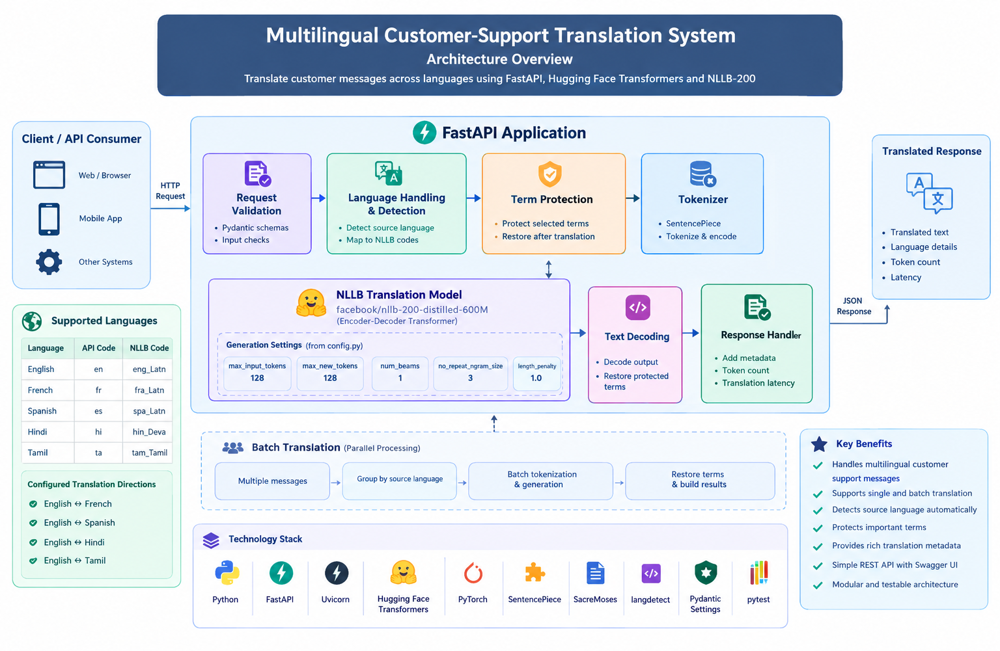

# Multilingual Customer-Support Translation System

A multilingual translation system built with **FastAPI, Hugging Face Transformers, PyTorch, and the NLLB-200 Distilled 600M model**.

The application translates customer-support messages between English, French, Spanish, Hindi, and Tamil through single-message and batch REST API endpoints. It also includes language detection, protected-term restoration, token counting, and translation latency reporting.

## Live Demo


---

## Table of Contents

- [Multilingual Customer-Support Translation System](#multilingual-customer-support-translation-system)
  - [Live Demo](#live-demo)
  - [Table of Contents](#table-of-contents)
  - [Project Overview](#project-overview)
  - [Features](#features)
  - [Technology Stack](#technology-stack)
  - [Supported Languages](#supported-languages)
  - [Model Configuration](#model-configuration)
  - [System Architecture](#system-architecture)
  - [Project Structure](#project-structure)
    - [Module Responsibilities](#module-responsibilities)
  - [Prerequisites](#prerequisites)
  - [Installation and Setup](#installation-and-setup)
    - [1. Clone the Repository](#1-clone-the-repository)
    - [2. Create a Virtual Environment](#2-create-a-virtual-environment)
    - [3. Install Dependencies](#3-install-dependencies)
    - [4. Configure Environment Variables](#4-configure-environment-variables)
  - [Running the Application](#running-the-application)
  - [API Endpoints](#api-endpoints)
    - [1. Single Translation](#1-single-translation)
    - [2. Batch Translation](#2-batch-translation)
  - [Testing](#testing)
    - [Using Swagger UI](#using-swagger-ui)
    - [Using curl](#using-curl)
    - [Running Unit Tests](#running-unit-tests)
  - [Performance and Limitations](#performance-and-limitations)
    - [Translation Quality](#translation-quality)
    - [CPU Performance](#cpu-performance)
    - [Language Detection](#language-detection)
    - [Resource Requirements](#resource-requirements)
    - [Evaluation](#evaluation)
  - [Deployment](#deployment)
  - [Model and Licensing](#model-and-licensing)
  - [Future Improvements](#future-improvements)
  - [Author](#author)
    - [Areas of Interest](#areas-of-interest)

---

## Project Overview

Customer-support teams often receive messages in different languages. This project provides a translation API to help process messages across language barriers.

The application uses a pretrained multilingual encoder-decoder Transformer model to translate text. Its modular backend separates configuration, model loading, language handling, request validation, term protection, and translation logic.

## Features

- **Multilingual translation:** Supports configured language directions across five languages.
- **Single translation:** Translates one message per API request.
- **Batch translation:** Processes multiple messages in one request.
- **Language detection:** Provides source-language detection functionality.
- **Term protection:** Helps preserve selected technical terms, identifiers, URLs, and other protected text.
- **Translation metadata:** Returns language details, input token counts, and processing latency.
- **REST API:** Exposes translation functionality through FastAPI.
- **Interactive API documentation:** Supports endpoint testing through Swagger UI.
- **Modular architecture:** Separates configuration, model loading, language detection, schemas, and translation logic.
- **Automated tests:** Includes unit tests for language detection and term protection.

## Technology Stack

| Technology | Purpose |
|---|---|
| Python | Core programming language |
| FastAPI | REST API framework |
| Uvicorn | ASGI application server |
| Hugging Face Transformers | Pretrained model integration |
| PyTorch | Model inference |
| NLLB-200 Distilled 600M | Multilingual translation model |
| SentencePiece | Tokenization support |
| SacreMoses | Text-processing dependency |
| langdetect | Language detection |
| Pydantic Settings | Application configuration |
| pytest | Automated testing |

## Supported Languages

| Language | API Code | NLLB Language Code |
|---|---|---|
| English | `en` | `eng_Latn` |
| French | `fr` | `fra_Latn` |
| Spanish | `es` | `spa_Latn` |
| Hindi | `hi` | `hin_Deva` |
| Tamil | `ta` | `tam_Taml` |

The configured translation directions are:

- English ↔ French
- English ↔ Spanish
- English ↔ Hindi
- English ↔ Tamil

Only the directions enabled in the application configuration are supported by the API.

## Model Configuration

| Setting | Current Value |
|---|---|
| Model | `facebook/nllb-200-distilled-600M` |
| Architecture | Encoder-decoder Transformer |
| Translation strategy | Generation with configurable beam search |
| Number of beams | `1` |
| Maximum input length | `128` tokens |
| Maximum generated tokens | `128` |
| No-repeat n-gram size | `3` |
| Length penalty | `1.0` |
| Configured batch processing size | `8` |
| Precision | FP16 on CUDA when available; FP32 on CPU |

These settings are intended to limit inference workload on resource-constrained environments. Longer messages or translations may be limited by the configured token lengths.

The application uses a pretrained model for inference. It does not train the translation model from scratch.

## System Architecture

```text
Client / API Consumer
        |
        v
     FastAPI
        |
        v
 Request Validation
        |
        v
Language Handling / Detection
        |
        v
 Protect Selected Terms
        |
        v
      Tokenizer
        |
        v
 NLLB Translation Model
        |
        v
    Text Decoding
        |
        v
 Restore Protected Terms
        |
        v
 JSON Translation Response
```

For batch requests, multiple messages are submitted together and processed through the batch translation path. The response contains the individual results.



## Project Structure

```text
multilingual-translation-system/
│
├── app/
│   ├── __init__.py
│   ├── config.py
│   ├── language_detection.py
│   ├── main.py
│   ├── model_loader.py
│   ├── schemas.py
│   ├── term_protection.py
│   └── translation_service.py
│
├── static/
│   ├── icons/
│   │   ├── github.png
│   │   └── linkedin.png
│   ├── script.js
│   └── style.css
│
├── templates/
│   └── index.html
│
├── tests/
│   ├── test_language_detection.py
│   └── test_term_protection.py
│
├── .env.example
├── .gitignore
├── .python-version
├── README.md
├── render.yaml
└── requirements.txt
```

### Module Responsibilities

| Module | Responsibility |
|---|---|
| `config.py` | Application settings, model configuration, and language mappings |
| `language_detection.py` | Source-language detection |
| `main.py` | FastAPI application lifecycle and API endpoints |
| `model_loader.py` | Tokenizer and translation model initialization |
| `schemas.py` | Request and response validation |
| `term_protection.py` | Protection and restoration of selected terms |
| `translation_service.py` | Single and batch translation logic |
| `tests/` | Unit tests for selected components |

## Prerequisites

- Python 3.11 recommended for a consistent development environment.
- Git.
- Internet access to download the pretrained model on the first run.
- Sufficient RAM and disk space for the model and its dependencies.

The translation model is relatively large, so CPU inference may take several seconds or longer depending on the hardware and input length.

## Installation and Setup

### 1. Clone the Repository

Replace `YOUR_GITHUB_USERNAME` with your GitHub username.

```bash
git clone https://github.com/YOUR_GITHUB_USERNAME/multilingual-translation-system.git
cd multilingual-translation-system
```

### 2. Create a Virtual Environment

**Windows PowerShell**

```powershell
py -3.11 -m venv .venv
.\.venv\Scripts\Activate.ps1
```

**macOS / Linux**

```bash
python3.11 -m venv .venv
source .venv/bin/activate
```

### 3. Install Dependencies

```bash
python -m pip install --upgrade pip
python -m pip install -r requirements.txt
```

Install pytest if it is not already available:

```bash
python -m pip install pytest
```

### 4. Configure Environment Variables

If `.env.example` is present, create a local `.env` file.

**Windows PowerShell**

```powershell
Copy-Item .env.example .env
```

**macOS / Linux**

```bash
cp .env.example .env
```

Update the values only if required by the application configuration. Never commit real credentials or secrets.

## Running the Application

From the project root, start the development server:

```bash
python -m uvicorn app.main:app --reload
```

Once the server starts, access the following URLs:

| Resource | URL |
|---|---|
| Application | http://127.0.0.1:8000 |
| Swagger documentation | http://127.0.0.1:8000/docs |
| ReDoc documentation | http://127.0.0.1:8000/redoc |
| Health endpoint | http://127.0.0.1:8000/health |

The first startup downloads the model if it is not already available in the Hugging Face cache. This may take several minutes depending on your internet connection.

Stop the server using `Ctrl+C`.

## API Endpoints

| Method | Endpoint | Description |
|---|---|---|
| `GET` | `/` | Basic application information |
| `GET` | `/health` | Health/status check |
| `POST` | `/api/translate` | Translate a single message |
| `POST` | `/api/translate/batch` | Translate multiple messages |

### 1. Single Translation

**Endpoint:** `POST /api/translate`

Example request:

```json
{
  "text": "I need a device to test this application",
  "source_language": "en",
  "target_language": "ta"
}
```

Example response:

```json
{
  "source_text": "i need a device to test this application",
  "translated_text": "இந்த பயன்பாட்டை சோதிக்க எனக்கு ஒரு சாதனம் தேவை",
  "source_language": "en",
  "source_language_name": "English",
  "target_language": "ta",
  "target_language_name": "Tamil",
  "source_nllb_code": "eng_Latn",
  "target_nllb_code": "tam_Taml",
  "detected_confidence": 1,
  "detection_note": "Source language provided by caller.",
  "input_token_count": 10,
  "latency_ms": 7575.24
}
```

The example illustrates the response format. Translation output, token counts, and latency can vary between requests.

### 2. Batch Translation

**Endpoint:** `POST /api/translate/batch`

The batch endpoint accepts multiple messages and returns an individual result for each message.

Example request:

```json
{
  "items": [
    {
      "text": "What is my order status?",
      "source_language": "en",
      "target_language": "ta"
    },
    {
      "text": "Please cancel my subscription and process the refund.",
      "source_language": "en",
      "target_language": "ta"
    }
  ]
}
```

Example response structure:

```json
{
  "count": 2,
  "results": [
    {
      "source_text": "What is my order status?",
      "translated_text": "என் ஆர்டர் நிலை என்ன?",
      "source_language": "en",
      "source_language_name": "English",
      "target_language": "ta",
      "target_language_name": "Tamil",
      "source_nllb_code": "eng_Latn",
      "target_nllb_code": "tam_Taml",
      "detected_confidence": 1,
      "detection_note": "Source language provided by caller",
      "input_token_count": 8,
      "latency_ms": 4503.92
    }
  ]
}
```

Use the actual request and response schemas in Swagger UI as the authoritative reference, especially for batch requests.

## Testing

### Using Swagger UI

1. Start the application.
2. Open http://127.0.0.1:8000/docs.
3. Expand `POST /api/translate` or `POST /api/translate/batch`.
4. Click **Try it out**.
5. Enter a request matching the displayed schema.
6. Click **Execute** and inspect the response.

### Using curl

Check the health endpoint:

```bash
curl http://127.0.0.1:8000/health
```

Example single translation request:

```bash
curl -X POST "http://127.0.0.1:8000/api/translate" \
  -H "Content-Type: application/json" \
  -d "{\"text\":\"I need a device to test this application\",\"source_language\":\"en\",\"target_language\":\"ta\"}"
```

### Running Unit Tests

Run all tests from the project root:

```bash
python -m pytest -q
```

Run individual test files:

```bash
python -m pytest -q tests/test_language_detection.py
python -m pytest -q tests/test_term_protection.py
```

These unit tests cover selected components. Additional integration tests should verify the running API and translation behavior across all configured language directions.

## Performance and Limitations

### Translation Quality

The model can produce understandable translations, but some sentences may sound unnatural or lose nuance. Quality depends on the language pair, context, spelling, informal language, and technical terminology.

A successful HTTP `200` response means the request was processed; it does not guarantee a perfect translation.

### CPU Performance

The application supports CPU inference, but translation may be slower than on suitable GPU hardware. Latency depends on the hardware, message length, model loading, and batch size.

### Language Detection

Automatic language detection may be unreliable for very short messages, names, identifiers, and mixed-language text. Providing the source language explicitly is preferable when it is known.

### Resource Requirements

The pretrained model requires substantial disk space and RAM. Small hosting instances may not have enough memory to load it reliably. Reducing token limits can reduce some inference workload, but does not eliminate the model's memory requirements.

### Evaluation

Translation quality should be evaluated using a representative dataset, automated metrics such as BLEU and chrF, and human review. Testing multiple language pairs and unseen customer-support messages is important before production use.

## Deployment

The repository includes `render.yaml` if that file is committed. Review the deployment configuration and available service resources before deploying.

A typical Uvicorn start command for a hosted service is:

```bash
uvicorn app.main:app --host 0.0.0.0 --port $PORT
```

Before deployment:

- Verify that the service has enough memory for the model.
- Confirm model downloads and cache behavior.
- Configure the correct start command and health-check path.
- Test single and batch translation endpoints after deployment.
- Keep credentials out of source control.
- Monitor startup time, latency, and memory usage.
- Review the model licence and intended-use restrictions.

**Render Free plan note:** Free services have resource limitations and may spin down after inactivity. Model startup, memory consumption, and translation latency should be tested on the actual deployed service. Successful local inference does not guarantee reliable operation on the free tier.

## Model and Licensing

This project uses the [NLLB-200 Distilled 600M model](https://huggingface.co/facebook/nllb-200-distilled-600M), developed by Meta AI.

- **Model:** `facebook/nllb-200-distilled-600M`
- **Model licence:** CC-BY-NC 4.0
- **Model card:** https://huggingface.co/facebook/nllb-200-distilled-600M
- **Licence terms:** https://creativecommons.org/licenses/by-nc/4.0/

This is a personal, non-commercial portfolio and learning project. The model is used subject to its applicable licence terms and restrictions. The model card describes its intended use primarily for research.

Attribution and a non-commercial project description do not, by themselves, guarantee compliance in every circumstance. Review the model card and licence terms before changing the project's purpose or using it commercially.

The application code is a separate work from the pretrained model. Its source-code licence should be selected and documented separately by the repository owner. Other dependencies may have their own licence terms.

This project is an independent implementation and is not affiliated with or endorsed by Meta AI.

## Future Improvements

- Expand automated integration testing across all configured language directions.
- Build a curated translation evaluation dataset.
- Compare translation quality using BLEU, chrF, and human review.
- Evaluate alternative models if improved fluency or different licensing permissions are required.
- Add production monitoring, request limits, and stronger error handling.
- Document an end-to-end translation dry run.

## Author

**Dinesh Kumar Alagarsamy**

*Software Quality Engineer / SDET*

- **GitHub:** https://github.com/a-dinesh-kumar
- **LinkedIn:** https://www.linkedin.com/in/dinesh-kumar-alagarsamy

### Areas of Interest

- Quality Engineering
- Test Automation
- API Testing
- Artificial Intelligence
- Machine Learning
- AI-powered Testing
- Software Architecture
- Generative AI and Agentic AI
